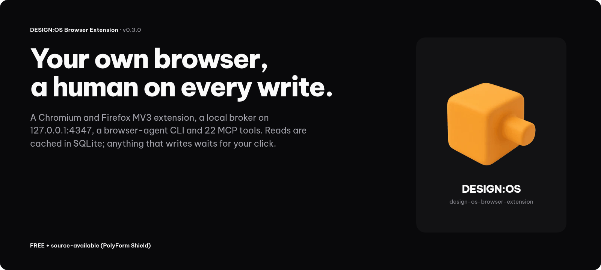
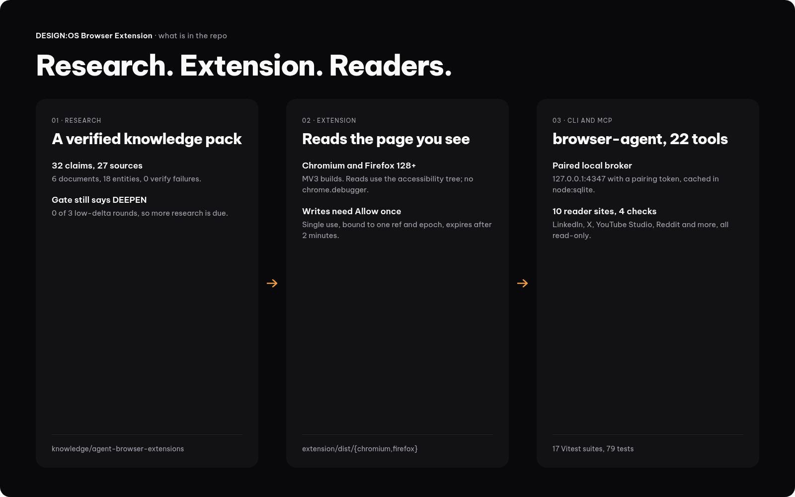

# DESIGN:OS Browser Extension

<p>
<picture>
  <source media="(prefers-color-scheme: dark)" srcset="docs/images/readme/cover-dark.png">
  <source media="(prefers-color-scheme: light)" srcset="docs/images/readme/cover-light.png">
  
</picture>
</p>

Cross-browser WebExtension engineering knowledge (`UKMC.v2`), TypeScript `7.0.2+` Agent RPC runtime, and **LinkedIn Zero-Drift Hybrid Adapter** that lets AI agents operate cleanly inside a user's own signed-in Chromium or Firefox browser without headless bots, `chrome.debugger`, or brittle API hashes.

The underlying `UKMC.v2` knowledge pack in [`knowledge/agent-browser-extensions/`](knowledge/agent-browser-extensions/) (`6` modules, `32` quoted claims, `27` sources, `18` entities, `0` verify failures) drives the compiled extension builds (`extension/dist/{chromium,firefox}`), local WebSocket broker (`127.0.0.1:4347`), `node:sqlite` cache, `browser-agent` CLI (`--json`), 12-tool MCP stdio server, `es-browser-agent` skill package, and multi-host agent workflows.

FREE + source-available ([PolyForm Shield 1.0.0](LICENSE)). Zero telemetry, zero cloud session proxy. See [PRIVACY.md](PRIVACY.md) and [SECURITY.md](SECURITY.md).

<p>
  <a href="#quickstart">Quickstart</a> · <a href="#use-with-your-ai-agent">Use with AI Agent</a> · <a href="#architecture-and-linkedin-adapter">Architecture</a> · <a href="#what-the-pack-covers">Knowledge Pack</a> · <a href="#how-it-was-built">How it was built</a> · <a href="#repository-layout">Layout</a> · <a href="#limits">Limits</a>
</p>

## Quickstart

Requires **Node >= 22**, **TypeScript >= 7.0.2**, and **Python >= 3.10** (stdlib only for pack & repo checks):

```bash
git clone https://github.com/jangtrinh/design-os-browser-extension.git
cd design-os-browser-extension

npm install
npm run typecheck
npm run build
npm test
python3 scripts/self_check.py --require-build
```

Attach your live Chromium or Firefox browser over `127.0.0.1:4347`:

```bash
# 1. Print your pairing token and start the loopback broker
node cli/dist/browser-agent.js daemon token --reveal --json
node cli/dist/browser-agent.js daemon start

# 2. Load unpacked extension:
#    - Chromium (Chrome / Arc / Brave): extension/dist/chromium
#    - Firefox 128+: about:debugging -> extension/dist/firefox/manifest.json
#    Open the extension popup -> paste pairing token -> Save & Connect.

# 3. Query your open LinkedIn tab or local SQLite cache as JSON
node cli/dist/browser-agent.js linkedin status --json
node cli/dist/browser-agent.js linkedin profile --json
node cli/dist/browser-agent.js linkedin search --category people --query "AI" --json
node cli/dist/browser-agent.js linkedin draft --kind message --target linh-nguyen --body "Hi Linh..." --prefill --json
node cli/dist/browser-agent.js linkedin cache --sql "SELECT public_identifier, full_name, source FROM profiles LIMIT 20" --json

# 4. Run 12-tool stdio MCP server (.mcp.json) or headless Chrome MV3 E2E visual check
node cli/dist/browser-agent.js mcp
npm run test:e2e
```

To query the `UKMC.v2` knowledge graph directly, place [`design-os-knowledge-builder`](https://github.com/jangtrinh/design-os-knowledge-builder) next to this repository:

```bash
export PYTHONPATH="${KNOWLEDGE_BUILDER_REPO:-../design-os-knowledge-builder}/src"
P="knowledge/agent-browser-extensions"

python3 -m knowledge_builder.cli pack status --root "$P"
python3 -m knowledge_builder.cli pack check --root "$P"
python3 -m knowledge_builder.cli query --root "$P" --object-type bridge-primitive --fields id,object_type,path
python3 "${KNOWLEDGE_BUILDER_REPO:-../design-os-knowledge-builder}/skills/es-knowledge-forge/validate.py" --root "$P"
```

## Use with your AI agent

Install the canonical `es:skill-forge v2` tool-product skill and interactive workflows into Claude Code, Codex CLI, Gemini CLI, and Antigravity:

```bash
node scripts/skill_contract.mjs
node scripts/sync_host_bundles.mjs --install-local
```

- **Canonical Skill:** [`skills/es-browser-agent/SKILL.md`](skills/es-browser-agent/SKILL.md) with [`concepts.md`](skills/es-browser-agent/concepts.md), [`rules.md`](skills/es-browser-agent/rules.md) (`R1`–`R8`), [`look.md`](skills/es-browser-agent/look.md) (`L1`–`L8`), source-bound [`contract.md`](skills/es-browser-agent/contract.md), [`build.mjs`](skills/es-browser-agent/build.mjs), [`validate.mjs`](skills/es-browser-agent/validate.mjs), and [`look.mjs`](skills/es-browser-agent/look.mjs).
- **Agent Interaction Workflows:** [`workflows/linkedin-agent-workflow.md`](workflows/linkedin-agent-workflow.md) (LinkedIn Cache -> Zero-Drift Read -> Fenced Observe/Act -> Copilot Draft -> Human Gate Handoff), [`workflows/new-site-extension-workflow.md`](workflows/new-site-extension-workflow.md), [`commands/linkedin.md`](commands/linkedin.md), and [`commands/doctor.md`](commands/doctor.md).
- **Portable Host Bundles:** Synced copies under `bundles/{claude-code,codex,gemini,grok-build}/` plus `.mcp.json`, `.claude-plugin/`, `.codex-plugin/`, `.agents/plugins/`, and `.grok-plugin/` verified by `node scripts/sync_host_bundles.mjs --check`.

## Architecture and LinkedIn adapter

1. **Zero-Drift Hybrid LinkedIn Reader (`extension/src/adapters/linkedin/`):** Combines `ISOLATED`-world semantic DOM/ARIA + hydration extraction with a passive `MAIN`-world response observer (`passive-observer.ts`, loaded at `document_start`) that captures normalized `/voyager/api/` `included[]` entities across rotated `queryId` hashes — **0 hardcoded query hashes, 0 synthetic background fetches, and 0 `chrome.debugger` permissions**.
2. **Fenced Dispatch & Page Epoch (`extension/src/core/page-epoch-store.ts`):** Every UI mutation checks `(tabId, pageId, epoch, leaseId)` stored in `storage.session`, rejects stale navigation refs (`BROWSER_PAGE_STALE`), and retires timed-out writes to `UNCERTAIN` (`retryable: false`).
3. **Human-Only Copilot Approval Queue (`extension/src/adapters/linkedin/copilot-composer.ts`):** `linkedin.draft.create` pre-fills visible composers without clicking Send (`sent: false`). Only human clicks inside `extension-popup` can mark queue items approved (`agent-rpc` self-approval is rejected with `BLOCKED_POLICY`).
4. **Human Gate Handoff (`extension/src/core/human-gate-detector.ts`):** URL checkpoints (`/checkpoint/`, `/authwall`, `/premium/`), CAPTCHA iframes, and HTTP `429`/`451` signals immediately transition to `BLOCKED_CHALLENGE`, `BLOCKED_AUTH`, or `BLOCKED_PAYMENT` for manual resolution in the open tab.
5. **SQLite Local Cache (`cli/src/db/sqlite-cache.ts`):** Reads auto-persist into `node:sqlite` for sub-5ms read-only `SELECT` / `WITH` queries via CLI or MCP (`linkedin_query_cache`).

## What the pack covers

This is the real `look.py` sheet for the pack, rendered by knowledge-builder from `index.json` and the run ledger. The local checkout path in its header is barred out; nothing else is edited.

<p>

</p>

<sub>design:os by Jang</sub>

Core browser engineering findings backed by frozen claims in the pack:

- Chrome 136 ignores `--remote-debugging-port` on the default user data directory.
- Chrome stops an MV3 extension service worker after 30 seconds of inactivity; a 20-second WebSocket keepalive resets that timer.
- Clicks sent with `HTMLElement.click()` or `dispatchEvent()` carry `isTrusted: false`.
- Firefox MV3 rejects `background.service_worker` and runs event pages through `background.scripts`.
- Safari web extensions ship inside a native Xcode app container for App Store distribution.
- Native Messaging caps one message at 1 MB from the host and 64 MiB to the host.

The six documents:

| Document | Type | Covers |
| :--- | :--- | :--- |
| [`cross-browser-capability-matrix.md`](knowledge/agent-browser-extensions/cross-browser-capability-matrix.md) | comparison | What Chromium, Firefox and Safari each allow, and the `service_worker` versus `background.scripts` split |
| [`transport-and-mv3-lifecycle.md`](knowledge/agent-browser-extensions/transport-and-mv3-lifecycle.md) | guide | Native Messaging framing and size caps, a `127.0.0.1` WebSocket with keepalive, `storage.session` recovery |
| [`execution-worlds-and-state-reading.md`](knowledge/agent-browser-extensions/execution-worlds-and-state-reading.md) | guide | `ISOLATED` and `MAIN` worlds, page CSP, reading SPA state, `chrome.offscreen` |
| [`trusted-input-shadow-and-oopif.md`](knowledge/agent-browser-extensions/trusted-input-shadow-and-oopif.md) | guide | `isTrusted`, `chrome.debugger` `Input.*`, out-of-process iframes, closed shadow roots, WebDriver BiDi |
| [`fast-snapshot-and-fenced-dispatch.md`](knowledge/agent-browser-extensions/fast-snapshot-and-fenced-dispatch.md) | guide | Compact DOM snapshots and `pageId` / `epoch` / `lease` fencing before any write |
| [`security-and-human-handoff.md`](knowledge/agent-browser-extensions/security-and-human-handoff.md) | decision record | Treating page text as untrusted, `sender.origin` checks, `activeTab`, and handing CAPTCHAs, sign-ins and payments back to the person |

The 18 entities are 3 browser engines, 8 bridge primitives and 7 interaction barriers. Canonical glossary terms live in [CONTEXT.md](CONTEXT.md).

## How it was built

<p>
<picture>
  <source media="(prefers-color-scheme: dark)" srcset="docs/images/readme/flow-dark.png">
  <source media="(prefers-color-scheme: light)" srcset="docs/images/readme/flow-light.png">
  
</picture>
</p>

1. **Sources & Claims (`UKMC.v2`):** 40 captured items -> 27 source objects -> 32 quoted claims across 6 documents, independently reviewed in `_evidence/agent-browser-extensions-261116/review.json`. Never hand-edit `claims/`, `sources/`, `captures.jsonl`, or `index.json`.
2. **Engine & Adapter (`v0.2.0`):** Shared TypeScript `>= 7.0.2` RPC contracts (`shared/`), Chromium & Firefox MV3 extension builds (`extension/`), `127.0.0.1:4347` broker + `node:sqlite` + CLI + MCP (`cli/`), and `es:skill-forge v2` tool-product package (`skills/es-browser-agent/`, `workflows/`, `bundles/`).

## Repository layout

| Path | Status in `v0.2.0` |
| :--- | :--- |
| [`knowledge/agent-browser-extensions/`](knowledge/agent-browser-extensions/) | Verified `UKMC.v2` pack (`ontology.yaml`, 6 docs, 32 claims, 27 sources, 18 entities, `index.json`, `_evidence/`) |
| [`shared/`](shared/) | Shared TypeScript `>= 7.0.2` `Agent RPC` envelope, capability tier, native 32-bit framing, LinkedIn schemas |
| [`extension/`](extension/) | Chromium & Firefox MV3 builds, `Page Epoch` store, Operate popup, passive `MAIN` observer, LinkedIn adapter |
| [`cli/`](cli/) | `127.0.0.1:4347` WebSocket broker, `node:sqlite` cache, `browser-agent` CLI (`--json`), 12-tool MCP stdio server |
| [`skills/es-browser-agent/`](skills/es-browser-agent/) | Tool-product skill (`SKILL.md`, `concepts.md`, `rules.md`, `look.md`, `contract.md`, `build`/`validate`/`look` scripts) |
| [`workflows/`](workflows/) & [`commands/`](commands/) | Agent playbooks ([LinkedIn workflow](workflows/linkedin-agent-workflow.md), [New Site workflow](workflows/new-site-extension-workflow.md), `/doctor`, `/linkedin`) |
| [`bundles/`](bundles/) | Synced portable bundles for `claude-code`, `codex`, `gemini`, and `grok-build` |
| [`tests/`](tests/) | 6 Vitest suites (`13` tests covering fencing, Human Gate Handoff, normalizer, SQLite/MCP, manifests, `A1–A9` skill gates) |
| [`scripts/`](scripts/) | `build.mjs`, `e2e_visual_proof.mjs`, `skill_contract.mjs`, `sync_host_bundles.mjs`, `self_check.py`, `verify_bridge_primitives.py` |

## Limits

- Tier-3 Safari Web Extension still requires a native macOS/iOS Xcode App Container wrapper (`SafariWebExtensionHandler` host binary), documented in [`cross-browser-capability-matrix.md`](knowledge/agent-browser-extensions/cross-browser-capability-matrix.md) and not packaged as an `.app` bundle yet.
- The knowledge pack's stopping gate (`pack check`) sits at `DEEPEN` (`0/3` low-delta rounds): treat the research corpus as an extensible living pack alongside the `v0.2.0` runtime.
- Live LinkedIn testing operates strictly inside the user's authenticated browser session; fixture E2E runs (`npm run test:e2e`) cover deterministic Chromium MV3 attachment, rotated `queryId` passive capture, safe prefill, and `BLOCKED_CHALLENGE` halt without hitting live production accounts.

## DESIGN:OS

Browser Extension is one of the DESIGN:OS tools. The others: [Studio](https://github.com/jangtrinh/design-os-studio), [CLI](https://github.com/jangtrinh/design-os), [Bridge](https://github.com/jangtrinh/design-os-figma-plugin), [SVG Animation](https://github.com/jangtrinh/design-os-svg-animation), [3D Blender](https://github.com/jangtrinh/design-os-3d-blender), [Knowledge Builder](https://github.com/jangtrinh/design-os-knowledge-builder) and [mcp-bridge-go](https://github.com/jangtrinh/mcp-bridge-go). More on [jangtrinh.github.io](https://jangtrinh.github.io/).

Changelog: [CHANGELOG.md](CHANGELOG.md) · Index for AI agents: [llms.txt](llms.txt) · Agent rules: [AGENTS.md](AGENTS.md)

## Contributing and license

- [CONTRIBUTING.md](CONTRIBUTING.md) · [CODE_OF_CONDUCT.md](CODE_OF_CONDUCT.md) · [SECURITY.md](SECURITY.md) · [PRIVACY.md](PRIVACY.md)
- [PolyForm Shield 1.0.0](LICENSE). FREE to use and modify, including for paid client work; you may not resell it or build a competing product from it.

If `design-os-browser-extension` saves you time, a star on GitHub helps other engineers and AI agents find it.

<p align="left">
  <a href="https://buymeacoffee.com/jangtrinh">
    
  </a>
</p>

Built by [Jang Trịnh](https://github.com/jangtrinh), creative technologist and autonomous system architect.

[GitHub](https://github.com/jangtrinh) · [LinkedIn](https://www.linkedin.com/in/jangtrinh/) · [Hub](https://jangtrinh.github.io/) · [YouTube](https://www.youtube.com/@designosbyjang) · [X](https://x.com/Jangtrinhvn)
