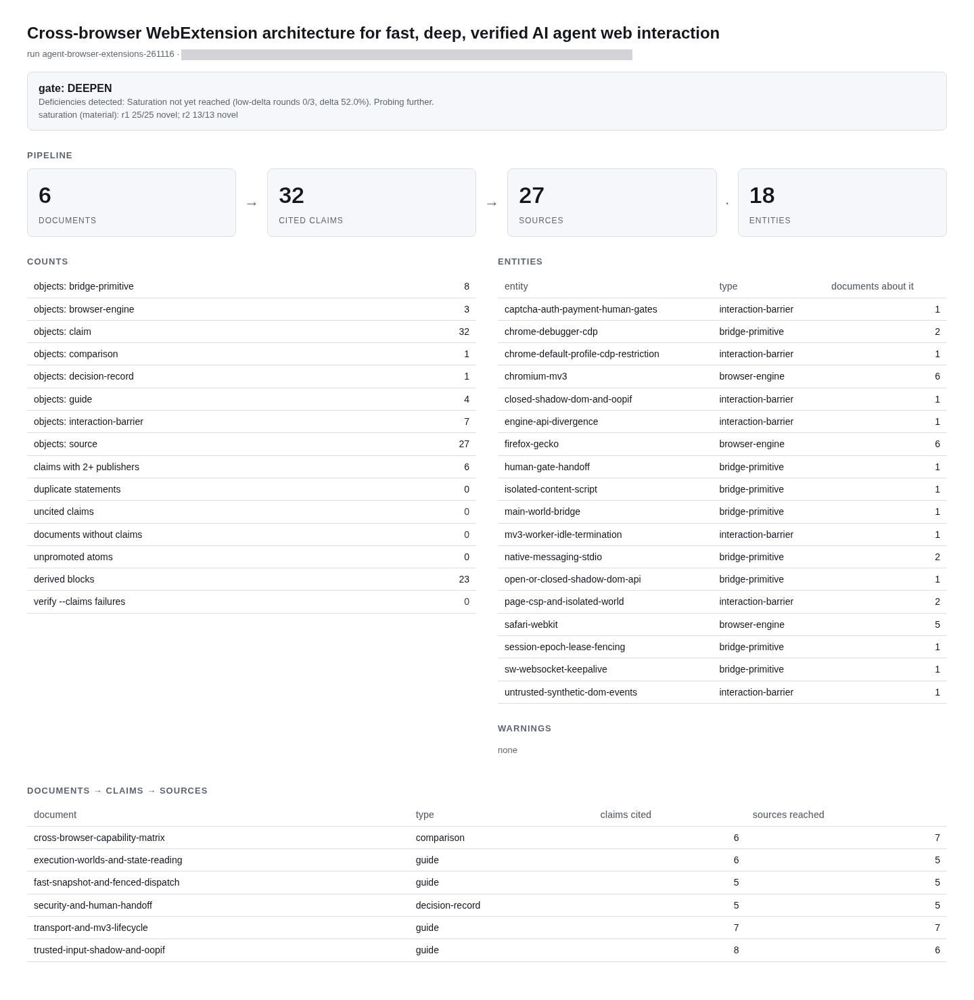

# DESIGN:OS Browser Extension

<p>
<picture>
  <source media="(prefers-color-scheme: dark)" srcset="docs/images/readme/cover-dark.png">
  <source media="(prefers-color-scheme: light)" srcset="docs/images/readme/cover-light.png">
  
</picture>
</p>

Research for a browser extension that lets an AI agent work inside a real user's browser, across Chromium, Firefox and Safari. Today the repository holds the research, not the extension: a `UKMC.v2` knowledge pack in [`knowledge/agent-browser-extensions/`](knowledge/agent-browser-extensions/), built and checked with [`design-os-knowledge-builder`](https://github.com/jangtrinh/design-os-knowledge-builder).

The pack has 6 documents, 32 claims, 27 sources and 18 entities. Every claim quotes a frozen copy of its source, and `verify --claims` reports 0 failures. The stopping gate still says `DEEPEN`: saturation is at 0 of 3 low-delta rounds, so more research rounds are due. The `extension/`, `cli/`, `shared/` and `tests/` folders are empty for now (each holds a `.gitkeep`), so there is no manifest, permission list or install step yet.

FREE + source-available ([PolyForm Shield 1.0.0](LICENSE)). The scripts make no network calls and send no telemetry. See [PRIVACY.md](PRIVACY.md).

<p>
  <a href="#quickstart">Quickstart</a> · <a href="#what-the-pack-covers">What the pack covers</a> · <a href="#how-it-was-built">How it was built</a> · <a href="#repository-layout">Layout</a> · <a href="#limits">Limits</a>
</p>

## Quickstart

The repo checks use the Python standard library only:

```bash
git clone https://github.com/jangtrinh/design-os-browser-extension.git
cd design-os-browser-extension
python3 scripts/self_check.py
python3 scripts/verify_bridge_primitives.py
```

`self_check.py` checks the required files, the LICENSE notice and the README wording, runs `verify_bridge_primitives.py`, and runs the pack's `validate.py` when a knowledge-builder checkout sits next to this one (or `KNOWLEDGE_BUILDER_REPO` points at it). `verify_bridge_primitives.py` round-trips a Native Messaging frame (32-bit length prefix, UTF-8 JSON).

To query the pack, clone [`design-os-knowledge-builder`](https://github.com/jangtrinh/design-os-knowledge-builder) next to this repository (it needs Python 3.10 or later):

```bash
export PYTHONPATH="${KNOWLEDGE_BUILDER_REPO:-../design-os-knowledge-builder}/src"
P="knowledge/agent-browser-extensions"

# Coverage and the stopping gate
python3 -m knowledge_builder.cli pack status --root "$P"
python3 -m knowledge_builder.cli pack check --root "$P"

# Bridge primitives, and which primitive overcomes a given barrier
python3 -m knowledge_builder.cli query --root "$P" --object-type bridge-primitive --fields id,object_type,path
python3 -m knowledge_builder.cli query --root "$P" --linked-to closed-shadow-dom-and-oopif --link-type overcomes --fields id,object_type,path

# The skill's rejection checks
python3 "${KNOWLEDGE_BUILDER_REPO:-../design-os-knowledge-builder}/skills/es-knowledge-forge/validate.py" --root "$P"
```

## What the pack covers

This is the real `look.py` sheet for the pack, rendered by knowledge-builder from `index.json` and the run ledger. The local checkout path in its header is barred out; nothing else is edited.

<p>

</p>

<sub>design:os by Jang</sub>

The research starts from problems an agent hits in a real browser, each backed by a claim in the pack:

- Chrome 136 ignores `--remote-debugging-port` on the default user data directory.
- Chrome stops an MV3 extension service worker after 30 seconds of inactivity; a 20-second WebSocket keepalive resets that timer.
- Clicks sent with `HTMLElement.click()` or `dispatchEvent()` carry `isTrusted: false`.
- Firefox MV3 does not support `background.service_worker` and runs event pages through `background.scripts`.
- Safari web extensions ship inside a native Xcode app container for App Store distribution.
- Native Messaging caps one message at 1 MB from the host and 64 MiB to the host.

The six documents:

| Document | Type | Covers |
| :--- | :--- | :--- |
| [`cross-browser-capability-matrix.md`](knowledge/agent-browser-extensions/cross-browser-capability-matrix.md) | comparison | What Chromium, Firefox and Safari each allow, and the `service_worker` versus `background.scripts` split |
| [`transport-and-mv3-lifecycle.md`](knowledge/agent-browser-extensions/transport-and-mv3-lifecycle.md) | guide | Native Messaging framing and size caps, a `127.0.0.1` WebSocket with keepalive, `storage.session` recovery |
| [`execution-worlds-and-state-reading.md`](knowledge/agent-browser-extensions/execution-worlds-and-state-reading.md) | guide | `ISOLATED` and `MAIN` worlds, page CSP, reading SPA state, `chrome.offscreen` |
| [`trusted-input-shadow-and-oopif.md`](knowledge/agent-browser-extensions/trusted-input-shadow-and-oopif.md) | guide | `isTrusted`, `chrome.debugger` `Input.*`, out-of-process iframes, closed shadow roots, WebDriver BiDi |
| [`fast-snapshot-and-fenced-dispatch.md`](knowledge/agent-browser-extensions/fast-snapshot-and-fenced-dispatch.md) | guide | Compact DOM snapshots and `pageId` / `epoch` / `lease` fencing before any write |
| [`security-and-human-handoff.md`](knowledge/agent-browser-extensions/security-and-human-handoff.md) | decision record | Treating page text as untrusted, `sender.origin` checks, `activeTab`, and handing CAPTCHAs, sign-ins and payments back to the person |

The 18 entities are 3 browser engines, 8 bridge primitives and 7 interaction barriers. The canonical terms are in [CONTEXT.md](CONTEXT.md).

## How it was built

<p>
<picture>
  <source media="(prefers-color-scheme: dark)" srcset="docs/images/readme/flow-dark.png">
  <source media="(prefers-color-scheme: light)" srcset="docs/images/readme/flow-light.png">
  
</picture>
</p>

1. **Sources.** One research run (`_evidence/agent-browser-extensions-261116/`) logged 40 captures in `captures.jsonl`: 39 fetched pages and 1 executed command. The pack records 27 source objects.
2. **Claims.** 32 claims, each quoting a frozen file. 6 of them have two or more publishers. None is uncited.
3. **Documents.** 6 documents cite the claims with `ease:claim` anchors. A second runtime re-fetched the sources and passed the review in `review.json`.
4. **Gate.** `pack check` returns `DEEPEN`, because saturation is at 0 of 3 low-delta rounds (delta 52.0%).

Claims, sources, `captures.jsonl` and `index.json` are never edited by hand. The pack grows only through `knowledge_builder.cli` (see [AGENTS.md](AGENTS.md)).

## Repository layout

| Path | What is there today |
| :--- | :--- |
| [`knowledge/agent-browser-extensions/`](knowledge/agent-browser-extensions/) | The `UKMC.v2` pack: `ontology.yaml`, documents, `claims/`, `sources/`, `entities/`, `index.json`, `_evidence/` |
| [`scripts/`](scripts/) | `self_check.py` and `verify_bridge_primitives.py` |
| `extension/`, `cli/`, `shared/`, `tests/` | Empty (`.gitkeep`). Planned homes for the extension, the host bridge CLI, the shared Agent RPC contract and the tests |
| `docs/adr/`, `plans/specs/` | Empty (`.gitkeep`) |

## Limits

- No extension, host CLI or tests exist yet. Nothing here can be installed in a browser.
- The stopping gate has not said `STOP_SUFFICIENT`. Treat the pack as a strong first round, not a finished survey.
- There is no CI workflow; run `scripts/self_check.py` before you commit.

## DESIGN:OS

Browser Extension is one of the DESIGN:OS tools. The others: [Studio](https://github.com/jangtrinh/design-os-studio), [CLI](https://github.com/jangtrinh/design-os), [Bridge](https://github.com/jangtrinh/design-os-figma-plugin), [SVG Animation](https://github.com/jangtrinh/design-os-svg-animation), [3D Blender](https://github.com/jangtrinh/design-os-3d-blender), [Knowledge Builder](https://github.com/jangtrinh/design-os-knowledge-builder) and [mcp-bridge-go](https://github.com/jangtrinh/mcp-bridge-go). More on [jangtrinh.github.io](https://jangtrinh.github.io/).

Changelog: [CHANGELOG.md](CHANGELOG.md) · Index for AI agents: [llms.txt](llms.txt) · Agent rules: [AGENTS.md](AGENTS.md)

## Contributing and license

- [CONTRIBUTING.md](CONTRIBUTING.md) · [CODE_OF_CONDUCT.md](CODE_OF_CONDUCT.md) · [SECURITY.md](SECURITY.md) · [PRIVACY.md](PRIVACY.md)
- [PolyForm Shield 1.0.0](LICENSE). FREE to use and modify, including for paid client work; you may not resell it or build a competing product from it.

If `design-os-browser-extension` saves you time, a star on GitHub helps other engineers and AI agents find it.

<p align="left">
  <a href="https://buymeacoffee.com/jangtrinh">
    
  </a>
</p>

Built by [Jang Trịnh](https://github.com/jangtrinh), creative technologist and autonomous system architect.

[GitHub](https://github.com/jangtrinh) · [LinkedIn](https://www.linkedin.com/in/jangtrinh/) · [Hub](https://jangtrinh.github.io/) · [YouTube](https://www.youtube.com/@designosbyjang) · [X](https://x.com/Jangtrinhvn)
