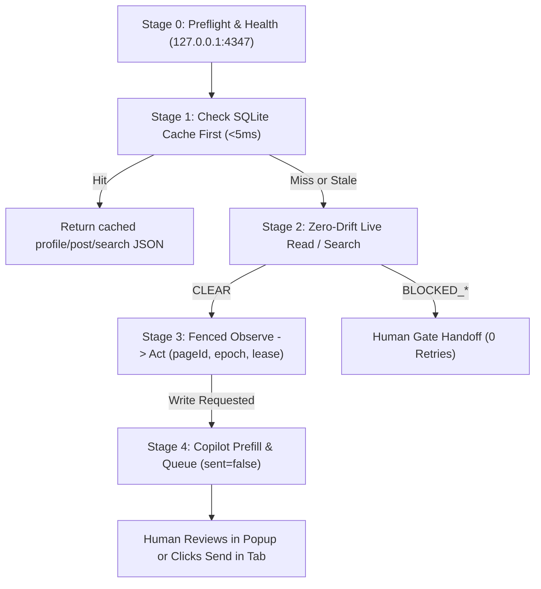

# LinkedIn Agent Interaction Workflow (`design-os-browser-extension`)

End-to-end operational workflow for AI coding & automation agents operating LinkedIn inside the user's real signed-in Chrome/Arc/Brave/Firefox session via `browser-agent` CLI (`--json`) or the 12-tool MCP `stdio` server.



## Stage 0 — Preflight & Pairing

1. Check broker and extension attachment:
   ```bash
   node cli/dist/browser-agent.js daemon status --json
   node cli/dist/browser-agent.js linkedin status --json
   ```
2. If `BROKER_UNREACHABLE`, start the broker (`daemon start`) and print the token (`daemon token --json`).
3. If `EXTENSION_OFFLINE`, instruct the user to paste the pairing token inside `chrome://extensions` / popup (`Save & Connect`).
4. Check `humanGate` in `linkedin status`: stop immediately with `0` retries if not `CLEAR`.

## Stage 1 — Cache-First Lookup (`node:sqlite`)

Query locally persisted entities before touching any live LinkedIn tab:

```bash
node cli/dist/browser-agent.js linkedin cache \
  --sql "SELECT public_identifier, full_name, headline, source, captured_at FROM profiles ORDER BY captured_at DESC LIMIT 25" \
  --json
```

Allowed tables: `profiles`, `posts`, `companies`, `jobs`, `threads`, `search_runs`, `copilot_queue`, `events`. Write/DDL/comment/multi-statement SQL is refused (`SQL_READ_ONLY_VIOLATION`).

## Stage 2 — Discovery & Zero-Drift Deep Read

Every command extracts semantic DOM/ARIA + passive `MAIN`-world `/voyager/api/` JSON entities (`included[]` without hardcoded `queryId` hashes) and auto-upserts into SQLite:

- `node cli/dist/browser-agent.js linkedin search --category people --query "<keywords>" --json`
- `node cli/dist/browser-agent.js linkedin profile --json`
- `node cli/dist/browser-agent.js linkedin post --json`
- `node cli/dist/browser-agent.js linkedin company --json`
- `node cli/dist/browser-agent.js linkedin job --json`
- `node cli/dist/browser-agent.js linkedin inbox --json` (or `--thread-id <id>`)
- `node cli/dist/browser-agent.js linkedin feed --json`

Equivalent MCP tools: `linkedin_status`, `linkedin_search`, `linkedin_get_profile`, `linkedin_get_post`, `linkedin_get_company`, `linkedin_get_job`, `linkedin_list_inbox`, `linkedin_query_cache`.

## Stage 3 — Fenced UI Observation & Interaction

1. Call `browser_observe` (`node cli/dist/browser-agent.js observe --json`) to inspect visible interactive elements (`[ref=N]`) and receive `{ tabId, pageId, epoch, leaseId }`.
2. Pass that exact fence to `browser_act` (`act --op click_ref|fill_ref --ref N --tab ... --page-id ... --epoch ... --lease-id ...`).
3. If navigation happened, stale refs reject cleanly (`BROWSER_PAGE_STALE`). If timed out (`UNCERTAIN`), reconcile via `observe` or `linkedin cache` — never blind-retry.

## Stage 4 — Copilot Draft & Human Approval Queue

When drafting a message, comment, post, or connection note:

```bash
node cli/dist/browser-agent.js linkedin draft \
  --kind message \
  --target "<public-id>" \
  --body "<message>" \
  --prefill \
  --json
```

- Always sets `sent: false` and parks in the **Copilot Approval Queue**.
- Never automate clicking Send or approving queue items over `agent-rpc` (`BLOCKED_POLICY`).

## Stage 5 — Human Gate Handoff & Recovery

On `BLOCKED_CHALLENGE` (`/checkpoint/`, CAPTCHA iframe, HTTP `429`/`451`), `BLOCKED_AUTH` (`/uas/login`, `/authwall`), or `BLOCKED_PAYMENT` (`/premium/`):
1. Halt all further browser calls immediately (`0` retries).
2. Report the active URL and state (`BLOCKED_*`) to the human user so they complete verification directly in the open tab.
